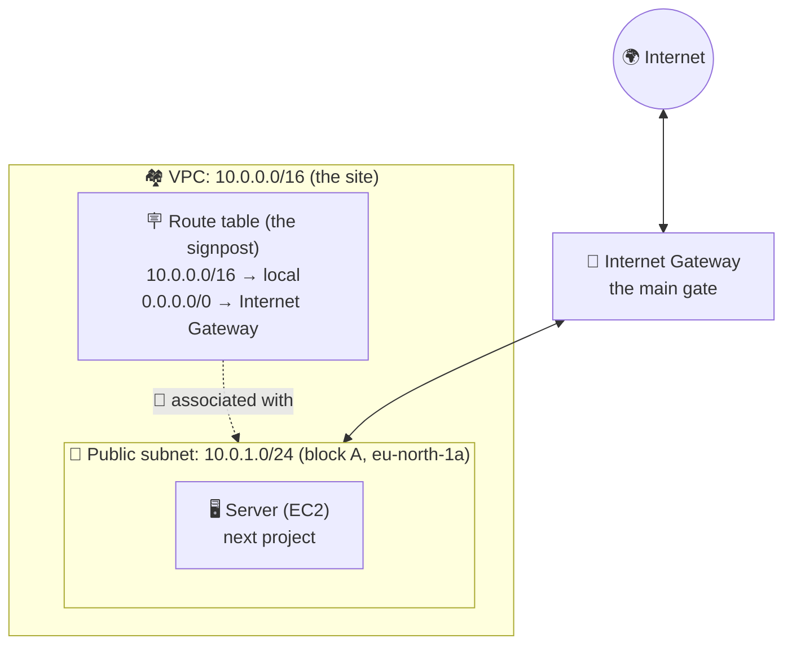

# 08 - Terraform + AWS: My own VPC

This project creates my own network in AWS: a **VPC** with a **public subnet**,
an **internet gateway** and a **route table**.
In the next project, I will put a server (EC2) inside this network.

## 🗺️ The big picture

## 🏘️ Lesson notes: a VPC is like a gated housing site

| AWS concept | In the site | What does it do? |
|---|---|---|
| **VPC** | The whole site, with walls | My private network. Nobody else can enter. |
| **CIDR block** | The address range of the site | Which IP addresses are inside the network |
| **Subnet** | A block in the site (block A, block B) | A part of the VPC. One subnet lives in **one** Availability Zone. |
| **Internet Gateway** | The main gate | The door between the VPC and the internet |
| **Route table** | The signposts | Tells traffic where to go |
| **Route table association** | Hanging the signpost on a block | Connects a route table to a subnet |
| **Security Group** | A guard at each door 💂 | A firewall for each server (next project) |

### 🔢 CIDR: the easy rule

An IP address has 4 numbers, like `10.0.1.5`. The number after `/` says **how many parts are fixed**:

| CIDR | Fixed | Free | Addresses |
|---|---|---|---|
| `/8` | First **1** number | Last 3 | `10.x.x.x` |
| `/16` | First **2** numbers | Last 2 | `10.0.x.x` (~65,000) |
| `/24` | First **3** numbers | Last 1 | `10.0.1.x` (256) |
| `/0` | **Nothing** | Everything | The whole internet 🌍 |

**A bigger number after `/` means a smaller area.** `/16` is the site, `/24` is a block inside it.

A subnet must be **inside** its VPC: `10.0.1.0/24` and `10.0.2.0/24` are both inside `10.0.0.0/16`.

**Private IP ranges** (used only inside networks, never on the internet):

| Range | Where I saw it |
|---|---|
| `10.0.0.0/8` | My own VPC |
| `172.16.0.0/12` | AWS default VPC (`172.31.0.0/16`), Docker networks |
| `192.168.0.0/16` | Home routers, Minikube (`192.168.49.2`) |

### 🚪 What makes a subnet "public"?

There is no "public" switch. A subnet is public when it has **a way out to the internet**:

1. 🚪 The VPC has an **Internet Gateway** (a gate)
2. 🪧 A **route table** has the rule `0.0.0.0/0 → Internet Gateway` ("for everywhere else, use the gate")
3. 🔗 The route table is **associated** with the subnet (the signpost is on this block)

Without the rule, the same subnet is **private**: the