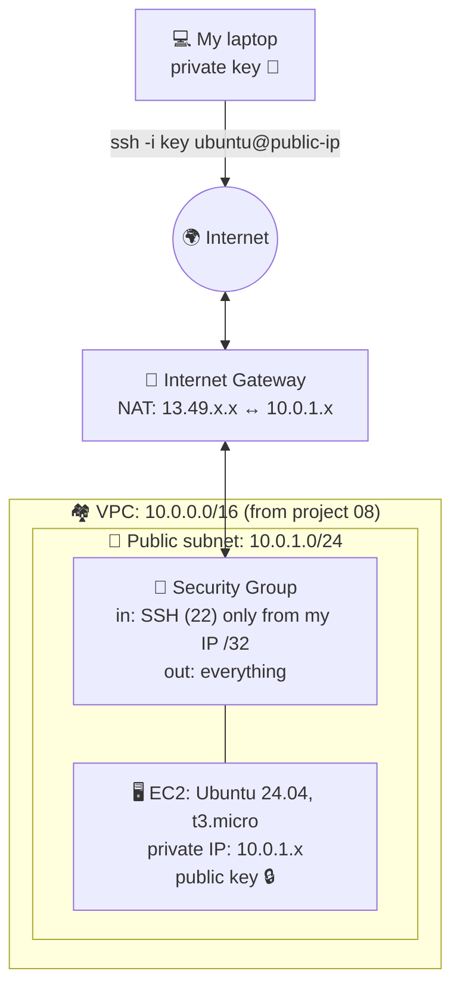

# 09 - Terraform + AWS: My first EC2 server

This project creates my first **virtual server (EC2)** in AWS, inside the network from project `08`.
Then I connect to it with **SSH**.

## 🗺️ The big picture



## 📚 Lesson notes

### EC2 concepts (with Docker in mind)

| EC2 | Docker | In the site | What is it? |
|---|---|---|---|
| **AMI** | Image | The plan of a flat | Operating system template (Ubuntu) |
| **Instance** | Container | The flat itself | A running virtual machine |
| **Instance type** | CPU/RAM limits | The size of the flat | `t3.micro`: 2 vCPU, 1 GB RAM |
| **Key pair** | - | The key of the flat 🔑 | SSH login without a password |
| **Security Group** | Port mapping | A guard at the door 💂 | Firewall for the server |
| **Public IP** | `localhost:8080` | The door number from outside | Address on the internet |

### 🔑 SSH key pair

| Key | Where? | Like |
|---|---|---|
| **Public key** (`.pub`) | Uploaded to AWS, put on the server | A lock 🔒: anyone can see it |
| **Private key** | **Only on my laptop** | The key 🔑: never shared, never in Git |

```bash
ssh-keygen -t ed25519 -f ~/.ssh/devops-journey -C "devops-journey"
```

On the first connection, SSH asks to trust the server's fingerprint and saves it in `~/.ssh/known_hosts`.
If the fingerprint changes later, SSH warns me (protection against *man-in-the-middle* attacks).

### 💂 Security Group rules

| Direction | Rule | Why? |
|---|---|---|
| **Inbound** | TCP port 22 (SSH), only from `my_ip/32` | Only I can connect. `/32` = exactly one IP address |
| **Outbound** | All traffic to `0.0.0.0/0` | The server can download updates (`apt`) |

Never open SSH to `0.0.0.0/0` (the whole internet)!

**Home IPs can change.** If SSH stops working, check `curl ifconfig.me` and update `terraform.tfvars`.

### 🌍 Two IPs, one server (NAT)

| | My home | My server |
|---|---|---|
| Private IP | `192.168.1.x` (from my modem) | `10.0.1.x` (from my subnet) |
| Public IP | From my internet provider | From AWS |
| Who translates? | My **modem** | The **Internet Gateway** |

The server only knows its private IP. The Internet Gateway translates between the public and the private IP.
This is **NAT** (Network Address Translation).

### 🔍 Resource vs data source

| | Resource | Data source |
|---|---|---|
| What does it do? | **Creates** something 🔨 | **Finds / reads** something that exists 🔍 |
| Example | `resource "aws_instance"` | `data "aws_vpc"` |
| Reference | `aws_instance.server.id` | `data.aws_vpc.main.id` |

Projects `08` and `09` have separate states. `09` cannot reference resources from `08`,
so it **finds** the VPC and the subnet by their `Name` tags with data sources.

### 💿 Finding the AMI safely

AMI IDs change often and are different in every region, so I never write them by hand.
A data source finds the newest Ubuntu 24.04 image:

- `most_recent = true` → pick the newest
- `owners = ["099720109477"]` → **only trust Canonical** (the company behind Ubuntu).
  Anyone can publish an AMI called "ubuntu", even with malware inside!
- `filter` on the name: `ubuntu/images/hvm-ssd-gp3/ubuntu-noble-24.04-amd64-server-*`

⚠️ A newer AMI can make `plan` want to **replace** the server (`-/+`). That is the price of "always the newest".

## 🧱 What it creates

| Type | Address | What? |
|---|---|---|
| data | `data.aws_vpc.main` | Finds the VPC from project `08` |
| data | `data.aws_subnet.public` | Finds the public subnet |
| data | `data.aws_ami.ubuntu` | Finds the newest Ubuntu 24.04 AMI |
| resource | `aws_key_pair` | Uploads my public key (`file("~/.ssh/devops-journey.pub")`) |
| resource | `aws_security_group.main` | The guard 💂 |
| resource | `aws_vpc_security_group_ingress_rule` | SSH from my IP |
| resource | `aws_vpc_security_group_egress_rule` | All outbound traffic |
| resource | `aws_instance.server` | The server 🖥️ |

**Output:** `server_public_ip`

**Variable:** `my_ip`: my public IP with `/32`. Its value is in `terraform.tfvars` (not in Git).
See `terraform.tfvars.example`.

## 🚀 How to run

Requirements: project `08` (the VPC) must exist, and an SSH key in `~/.ssh/devops-journey`.

```bash
aws login
curl ifconfig.me                  # my public IP → terraform.tfvars
cp terraform.tfvars.example terraform.tfvars

terraform init
terraform plan
terraform apply

ssh -i ~/.ssh/devops-journey ubuntu@<server_public_ip>
```

## 💰 Cost

The EC2 server is paid **per hour** (from my Free plan credits).
**When I finish a session, I run `terraform destroy`.** The next `terraform apply` brings everything back. 🔄

## 💡 What I learned

- **Everything comes together:** VPC, subnet, gateway, route table, public IP, Security Group, key pair and AMI.
- **`file()`** reads a file's content. Use the `.pub` file, never the private key!
- **`vpc_security_group_ids` is a list** (`[...]`), because a server can have many Security Groups.
- **`.id` vs `.public_ip`:** The ID is like a title deed (`i-...`), the public IP is the address.
- **Read every plan:** An unexpected `1 to destroy` showed that changing a resource label means "delete and create".
- **`moved` block:** Renames a resource in the state without destroying it:
```hcl
  moved {
    from = aws_key_pair.old_name
    to   = aws_key_pair.new_name
  }
```
- **Check the region in the console:** AWS shows resources per region.
- **Manage with Terraform, not the console:** Stopping a server in the console creates drift.